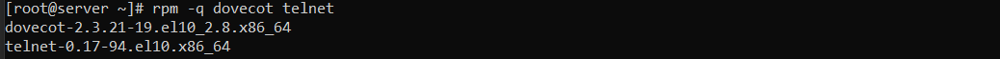
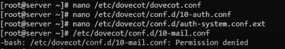
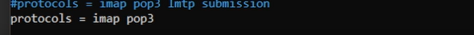
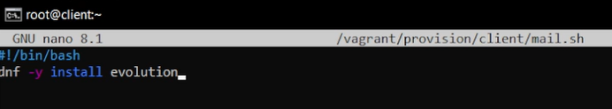
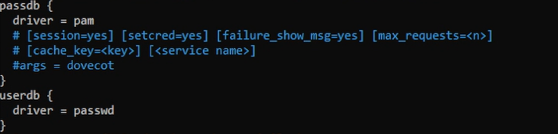
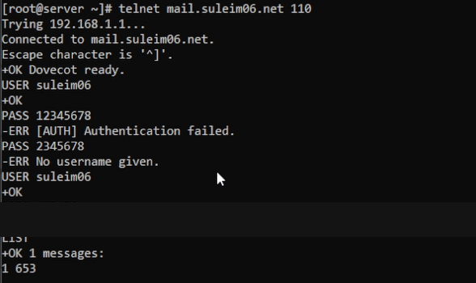
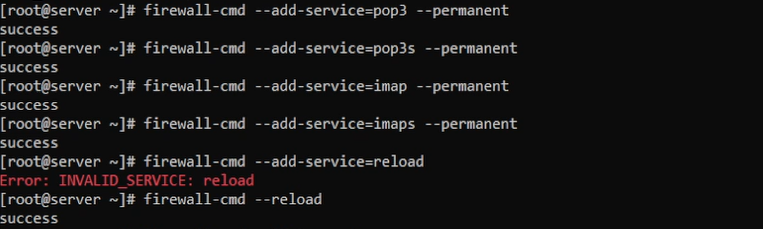
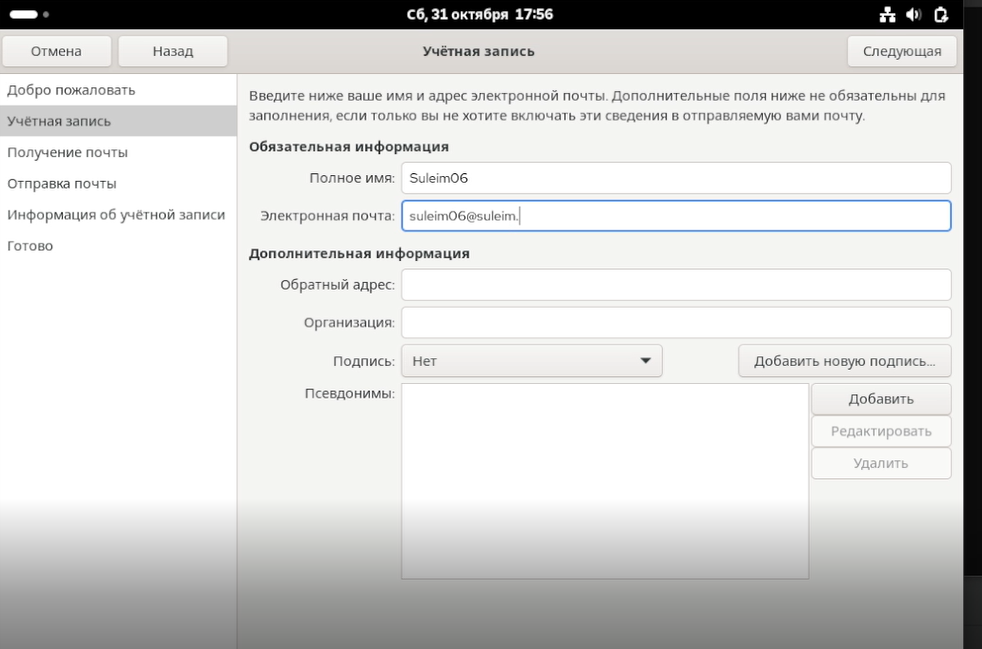
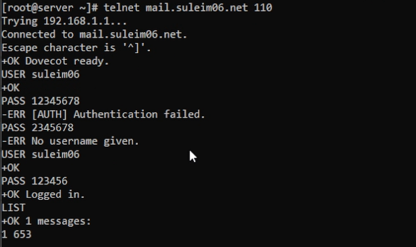
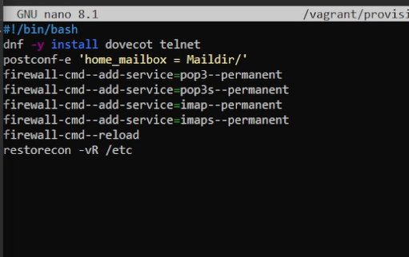

# Слайд 1. Титульный

**Презентация по лабораторной работе № 9**  
Настройка POP3/IMAP-сервера

Гамбердов Сулайм Исаевич  
Российский университет дружбы народов (РУДН)  
Группа НПИбд-01-24  
Преподаватель: Кулябов Дмитрий Сергеевич  
Москва · 31 октября 2026

# Слайд 2. Цели и задачи работы

## Цель

Приобретение практических навыков по установке и простейшему конфигурированию POP3/IMAP-сервера.

# Слайд 3. Исходная конфигурация

- Сервер: `server`, адрес `192.168.1.1`.
- Клиент: `client`, адрес `192.168.1.2`.
- Операционная система: Rocky Linux 10.
- Почтовая учётная запись: `suleim06`.
- Проверяемое имя сервера: `mail.suleim06.net`.

# Слайд 4. Установка программного обеспечения

На сервере проверено наличие Dovecot и Telnet командой `rpm -q dovecot telnet`.

Зафиксированные версии: Dovecot `2.3.21-19.el10_2.8` и Telnet `0.17-94.el10`.

# Слайд 5. Настройка протоколов Dovecot

В `dovecot.conf` установлено `protocols = imap pop3`.

# Слайд 6. Настройка аутентификации

В `10-auth.conf` задан механизм `auth_mechanisms = plain`. В `auth-system.conf.ext` показаны драйверы PAM и passwd.

# Слайд 7. Настройка межсетевого экрана

Добавлены постоянные правила для POP3, POP3S, IMAP и IMAPS. После ошибочной команды reload успешно выполнена команда `firewall-cmd --reload`.

# Слайд 8. Проверка POP3 через Telnet

Выполнено подключение к `mail.suleim06.net` на порт 110. После повторного ввода учётных данных получен ответ `+OK Logged in.` Команда LIST показала одно сообщение. Пароль скрыт на копии изображения.

# Слайд 9. Настройка Evolution

Открыт мастер добавления почтовой учётной записи Evolution. На снимке отображается имя Suleim06 и начало ввода адреса.

# Слайд 10. Подготовка тестового сообщения

В окне создания сообщения указан получатель `suleim06@suleim06.net` и тема `Proverka pochta`. После подготовки тестового сообщения выполнена проверка взаимодействия почтового клиента с сервером.

# Слайд 11. Автоматизация сервера

Подготовлен серверный скрипт `mail.sh` с командами установки Dovecot/Telnet, настройки Maildir и firewalld.

# Слайд 12. Автоматизация клиента

Подготовлен клиентский скрипт `mail.sh` с командой установки Evolution.

# Слайд 13. Проверка почтовой системы

После настройки почтового клиента была выполнена проверка взаимодействия Evolution с настроенным сервером. Это завершило практическую проверку клиентской части.

# Слайд 14. Выводы

Проверены настройки Dovecot, правила firewalld, POP3-аутентификация и работа почтового клиента с сервером. Подготовлены скрипты автоматизации для сервера и клиента.

# Слайд 15. Итог

Получены практические навыки установки и настройки POP3/IMAP-сервера, настройки аутентификации и межсетевого экрана, проверки POP3 через Telnet и работы с почтовым клиентом Evolution.
